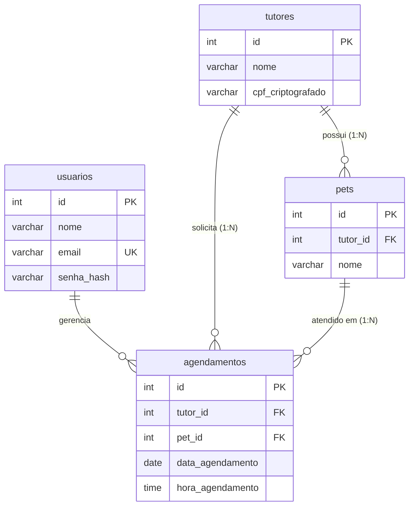

# Documentação Técnica — Sistema de Gerenciamento para Clínica Veterinária (Vetidi)

**Avaliação Prática de Desempenho dos Estudantes — SAEP**

**Tecnológias:** PHP 8.5, PostgreSQL e PDO.

**Padrão Arquitetural:** MVC desenvolvido sem frameworks.

---

## 1. Contextualização e Objetivo do Projeto
O **Vetidi** é uma aplicação web desenvolvida para automatizar a rotina operacional de uma clínica veterinária. Atualmente, o controle manual de fichas e horários gera desaparecimento de consultas, cadastros duplicados e insegurança no armazenamento de informações.

O sistema resolve esse cenário centralizando o atendimento de veterinários, recepcionistas e gestores, garantindo integridade nos registros e adequação à Lei Geral de Proteção de Dados (LGPD) por meio da proteção de informações sensíveis dos clientes.

### Pilares Técnicos da Solução
* **Privacidade e Conformidade (LGPD):** Proteção criptográfica para dados pessoais críticos (como o CPF).
* **Controle de Acesso:** Autenticação por credenciais com encerramento automático da sessão após período de ociosidade.
* **Qualidade de Código:** Estrutura organizada seguindo boas práticas de código limpo e princípios SOLID para facilitar futuras manutenções.

---

## 2. Requisitos Funcionais (RF)
As funcionalidades abaixo atendem às regras de negócio definidas para a operação diária da clínica:

* **RF-01 — Acesso ao Sistema (Login):** Validar as credenciais (e-mail e senha armazenada com hash seguro) e exibir mensagem de alerta caso a autenticação falhe. A sessão deve expirar automaticamente após 15 minutos sem atividade.
* **RF-02 — Encerramento de Sessão (Logout):** Disponibilizar opção clara para sair do sistema, limpando os dados de sessão e cookies ativos.
* **RF-03 — Tela Inicial (Dashboard):** Exibir o nome do profissional conectado e fornecer atalhos diretos para os módulos de tutores, pets, agendamentos e saída do sistema.
* **RF-04 — Registro de Tutores:** Permitir o cadastro de novos responsáveis, garantindo que o CPF seja gravado de forma criptografada no banco de dados.
* **RF-05 — Consulta e Listagem de Tutores:** Disponibilizar campo de filtro por termo para localizar tutores e atualizar a tabela de exibição conforme o resultado pesquisado.
* **RF-06 — Atualização de Tutores:** Permitir modificar os dados de um tutor já registrado e persistir as alterações no banco.
* **RF-07 — Cadastro de Pets:** Registrar novos animais vinculados obrigatoriamente a um tutor previamente cadastrado.
* **RF-08 — Visualização de Pets:** Listar todos os animais registrados na clínica com seus respectivos dados e responsáveis.
* **RF-09 — Criação e Consulta de Agendamentos:** Registrar novas consultas e exibir a agenda ordenada pela data do atendimento, apresentando os dados completos do tutor e do pet.
* **RF-10 — Reagendamento (Edição):** Permitir alterar a data e os detalhes de um agendamento existente, atualizando o registro no banco de dados.

---

## 4. Modelagem de Dados (DER)
A estrutura relacional abaixo representa as entidades do sistema:

---

## 5. Estrutura de Banco de Dados
O script SQL responsável pela criação do banco será nomeado como `saep_db.sql`. Ele contem:

* Criação das tabelas `usuarios`, `tutores`, `pets` e `agendamentos` com suas respectivas restrições (`PRIMARY KEY`, `FOREIGN KEY` e `UNIQUE`).
* Inserção inicial (`INSERT`) de no mínimo três registros válidos em cada tabela, garantindo massa de dados pronta para testes de listagem, busca e edição.

---

## 6. Organização da Aplicação e Entregas
* `saep_db.sql`: Script completo.
* `sistema/`: Diretório raiz do código-fonte da aplicação:
* `public/`: Ponto de entrada (`index.php`) e arquivos estáticos.
* `src/Controllers/`: Controladores de Autenticação (Login/Logout), Dashboard, Tutores, Pets e Agendamentos.
* `src/Models/`: Entidades e repositórios de acesso ao PostgreSQL.
* `src/Views/`: Interfaces HTML/PHP para interação com o usuário.